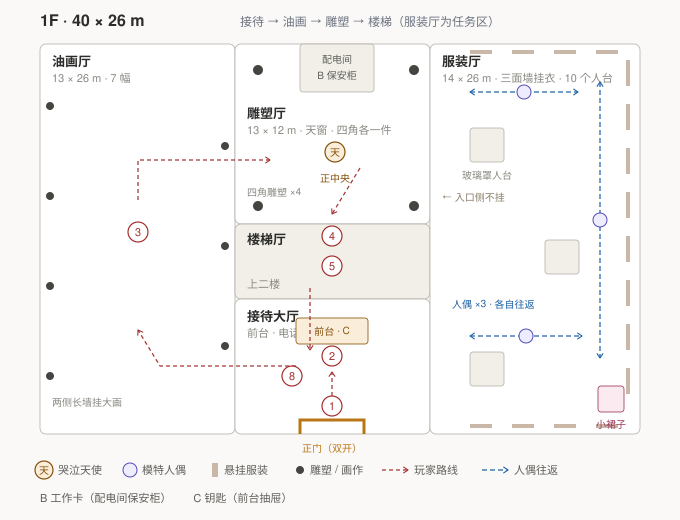
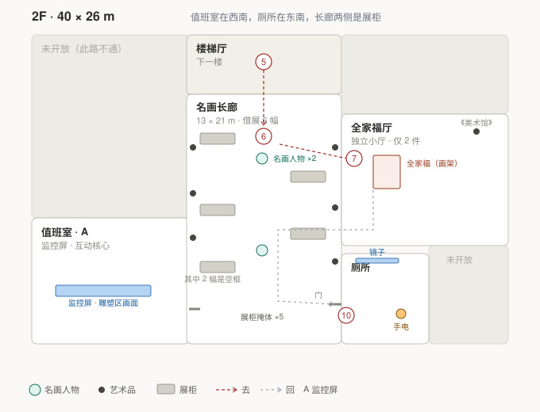

# 游戏设计文档（GDD）· Unity_Project_Ib

> 状态：草案 v2.2（按 Unity 工程已实现内容回写）　·　最后更新：2026-10-30
> 标记说明：✅ 已确定　🟡 倾向/待确认　❓ 待讨论（因剧情未定或技术未验证）　🔧 当前实现（以工程为准，v2.2 回写）

> **变更记录 · v2.2（2026-10-30）**：以 Unity 工程中已实现的内容为准回写，未实现的设计保持原样。
> 1. §5 新增「尺寸与 WorldScale」：馆内一切 × 1.4（孩子视角），玩家 1.3 m / 眼高 1.15 m 不放大；§5.1、§5.2 房间表改为「常量 / 实际」两列；§5.4《美术馆》尺寸、天使周围空圈补实际值。
> 2. §4.1 哭泣天使：按 `WeepingAngel.cs` 改为三阶段 Still / Peek / Attack + 巡逻 + NavMesh 追击 + 盯满 3 秒转追击（手电闪烁），补全代码默认数值；§4.3 数值项同步。
> 3. 配电间位置：§3.5、§5.5 由「雕塑厅北墙」改为「雕塑厅南墙中段（与接待厅相邻），门朝北正对天使」。
> 4. §5.4 油画厅展品改为实际挂的六幅名画；雕塑厅四角、一层楼梯厅、二层长廊展品改为实际布置。
> 5. §5.1 雕塑厅「天窗」注明为假天窗（发光板 + 冷色射灯）；值班室尺寸 13 × 10 → 13 × 10.6。
> 6. §3.2 空气墙注明当前为 5.2 m 宽硬碰撞；§3.4 补上已摆放的 6 个检查点位置；§5.1 补人群当前为白色圆柱占位（51 个）；人偶当前速度 0.7 m/s、接触判定未做。
> 7. §5.5 末条、§8 开发计划第 1、4、7、9、10 项补当前实现状态。

---

## 0. 项目定位

| 项目  | 内容                                            |
| --- | --------------------------------------------- |
| 类型  | 3D 第一人称恐怖游戏 Demo ✅                            |
| 目的  | 学习 Blender 建模 + Unity 游戏开发，非商业 ✅              |
| 版权  | 学习用途，模型/场景/名画素材无需考虑版权 ✅                       |
| 引擎  | Unity 6（6000.5.5f1）+ URP + New Input System ✅ |
| 建模  | Blender+Tripo+Hyper3D ✅                       |
| 规模  | 目标 Demo 时长约 **30 分钟** ✅ |
| 平台  | PC：**Mac + Windows** 双平台打包 ✅ |

## 1. 灵感来源

- **《恐怖美术馆 Ib》**：开场是热闹的美术馆，NPC 很多、展品可互动；剧情触发后整座美术馆空无一人。
- **《Doctor Who》哭泣天使**：被注视时化为石像，不被注视时移动。
- **《层层恐惧 Layers of Fear》**：玩家视线离开时场景悄然改变（“回头杀”）。

> 只借用**形式**：闹→空、被注视即静止、身后的世界会变。**解释权全部归本作自己的世界规则（§6.4）**，不沿用原作设定。

## 2. 核心体验（设计支柱）

1. **“刚才人还很多，突然一个人都没有”** ✅ —— 从日常到诡异的断崖式转变，只隔一次转身。
2. **“它们从来没有死过，只是有人在看的时候不动”** ✅ —— 白天那个安静、体面、让你放松警惕的美术馆，其实一直醒着。
3. **“不能相信自己身后的空间”** ✅ —— 视线之外的场景会变化，因为馆藏在布展。
4. **“爱你的人看着你，也会害死你”** ✅ —— 馆藏盯你时要命；画里的 Lily 盯你时温柔地要命。两种注视，一个后果。

## 3. 核心玩法

### 3.1 视角与操作
- 第一人称移动、环顾、交互（查看展品、拾取物品、开门）✅
- ✅ **身高 7 岁**：相机高度约 1.15 m，成人视平线在屏幕上偏上 —— 整个美术馆会显得过高、过大。
- ✅ **只做奔跑**（R1-3）：奔跑有明显更响的脚步声。**不做蹲下、不做躲藏** —— 甩开名画人物靠绕出它的视线，而不是躲进柜子。
- ✅ 玩家**没有任何反击手段** —— 玩家是一件藏品，打不过馆藏是设定，不是难度设计

### 3.2 开场（v1.1 按新流程重写）✅

#### 第一段 · 主菜单就是那个房间

- ✅ **主菜单背景不是一张图，是可进入的场景**：一幅全家福（**草稿**，见 §6.3）支在一只画架上。菜单项（开始游戏 / 设置 / 退出）浮在画面上。**不设“继续游戏”**（R1-4）。
- ✅ 房间**一片漆黑**，只有两处有光：**画架上的全家福**，和**十几米外一道半掩的双开门**，门缝里冒白光。
- ✅ 点“开始游戏”后，菜单项**逐个淡出**（不是整块消失），玩家接管角色。此时仍在看着那幅画。

#### 第二段 · 转身

- ✅ 初始视角正对全家福。玩家转身，才看见那道双开门 —— 全片第一次“回头”，也是核心体验 3 的第一次教学。
- ✅ 房间里除了画和门，只有画架脚下**一把刮刀** —— Grampus 就是握着它从这里走进画里的（§6.3；画室里那把刮刀从此不见了）。**空气墙**把可走范围限制在“画架 ⇄ 门”之间一条**宽约 3 m 的窄带**（R2-2）；边缘不用硬墙，而是**黑暗变浓 + 轻微阻力**，玩家能摸到画、能走到门，走不出这两点之外。
  - 🔧 当前实现：空气墙是**硬碰撞**的隐形墙，通道宽 **5.2 m**（常量 `AirBandHalfWidth = 2.6`，× 1.4 后约 7.3 m），画架后方留 1.3 m 可绕到画布背面；“黑暗变浓 + 轻微阻力”尚未实现。画架到门：常量 14 m，实际 19.6 m。
- ✅ 玩家可以凑近看画、可以摸到**空白处还是湿的** —— 此时不可能懂，但这是他第一次接触谜底（伏笔提前到开场）。

#### 第三段 · 推门

- ✅ 推开那道双开门 —— **门后不是一个房间，是整座美术馆**：灯光、人声、满地观众。
- ✅ **这道门就是《美术馆》画里的大厅正门。** 开场那间“黑屋”不是任何房间，是**《美术馆》这幅画的暗部**（父亲没画到的地方）。画架上那幅是 Grampus 画进《美术馆》里的**全家福草稿**，所以空白处摸上去是湿的（画层永远湿，§6.4-4）。推门 = 从没画的地方，走进画好的地方 —— 这是**进画**，不是出画（出画见 §3.6 第 6 步）。
- ✅ 门一关，回头已经没有门了 —— 只有一面墙。玩家只能往前走。
- ✅ 这道门在游戏最后会再出现一次（真实馆里的同一扇正门）：**拿钥匙开它 = 坏结局**（§3.5）。

#### 第四段 · 画中馆

- ✅ 人山人海。但**NPC 全部是固定站位**，不会走动：他们只在艺术品周围站成半圆，面朝作品，彼此不说话。
- ✅ 人群的异常要轻到第一遍只会觉得“有点怪”：从不与玩家对视、同一张脸出现在两组人群里、说话声像循环录音。
- ✅ **所有 NPC 的脸都是模糊的**（见 §6.4 规则 2）—— 不是马赛克，是**没画完的笔触**：五官位置对，但边缘化开，像没干的油画被人抹过一下。
- ✅ **全家福前永远站着一个模糊的大人**，背对人群、面朝那幅画，从不移动。他就是 Grampus（§6.3），第一遍只会当他是又一个看不清脸的观众。
- ✅ **画里的 Lily 始终站在玩家旁边**，玩家可以与这幅画互动：Lily 反复念同一句话：「门开着呢，你回来就看见了。」
- ✅ 这一段的任务只有一个字：**逛**。整座馆两层都开着，玩家可以随便走，看画、看人、看说明牌。
- ✅ 转折点：玩家上二楼，**与全家福互动**。互动结束后镜头锁在画上慢慢拉回，展厅从四周褪成黑色 —— 他回到了黑屋（第五段）。
- ✅ 画中馆全家福厅的北墙上挂着一幅**盖着布的画**（画不能把自己画进去）。出画后才知道布下面是《美术馆》。

#### 第五段 · 回到黑屋，出画（v1.7 新增）

- ✅ 镜头锁定全家福，缓慢拉回到主角视角；四周的画中馆**由外向内褪成黑色**，只剩那幅画。镜头回到手里时，它已经是黑屋画架上的那幅草稿 —— **全程一刀不剪**。画里的空间不守物理：画中馆展厅里的全家福，和黑屋画架上的草稿，本来就是同一笔。
- ✅ 玩家转身：当初双开门的位置，**门不见了，换成一个空画框**，框里透进真实馆的光（月光色，冷）。这是黑屋第二次出现，也是全片第二次“转身才看见出口”。
- ✅ 黑屋从此是**双向的边界**：进画走门，出画走画框。**Ted 出画的路，正是 Grampus 当年进画的路**（规则 12）。
- ✅ 玩家穿过画框，落在**真实馆二楼全家福厅**里。他一回头：身后的画框已经变成了墙上的**《美术馆》** —— 观众席上少了一个小人，全家福前站着一个模糊的大人。**明示：他是从这幅画里走出来的。**
- ✅ 画框变回《美术馆》用 §3.3 的视锥系统实现：玩家背对时替换。这是全片**第一次“回头杀”**，为后面馆藏布展做教学。
- ✅ 实现（R4-3）：黑屋是独立区域；空画框里贴一张**实时 RenderTexture**，由全家福厅里与玩家相对位置同步的摄像机拍摄，玩家能先透过画框看见真实馆；跨过画框的瞬间瞬移到全家福厅。性能不够时退路：跨框瞬间白光一闪掩盖瞬移，画框里只放静态画面。
- ✅ **画框只开一次**：出来之后《美术馆》就关上了，再摸只是画布（与 §7.1“门已经用完了”对应）。他真正该回去的地方是全家福，不是《美术馆》。

### 3.3 动态场景变化（视锥 / 遮挡驱动）
- ✅ 机制不变：物体或区域**不在玩家视野内**才改变。
- ✅ **变化的原因已由剧情定死 —— 馆藏在布展**：
  - 门变墙 = 通道被封住，防止展品跑出展区
  - 走廊延长 = 把你引回陈列区
  - 画作内容改变 = 正在重新挂画
  - 展品位置移动 = 它们在被归位
- ✅ **馆藏不驱赶，只追捕**（N4）。布展只负责封路、改路，不负责把玩家引向哪里；把玩家带到正门的是任务提示、门锁和钥匙（§6.7）。
- ✅ 全家福厅的岔口开在**名画长廊**中段，也就是名画人物的地盘：想回去，就得穿过它们。它们追得最紧，是因为**不想让他归位** —— 一回到自己的画里，他就从馆藏清单上除名了（§6.4-6）。
- ✅ 用途：氛围 + 软引导（不是硬谜题，不做成迷宫）
- ✅ 技术方案（R4-2）：`GeometryUtility.TestPlanesAABB` 判断包围盒是否在视锥内 + 对包围盒的几个角点做**多点射线**判断遮挡；不用 `Renderer.isVisible`（会把阴影投射和 Scene 视图算成“看见”）。实现细节待原型验证。

### 3.4 生命 / 失败机制 ✅
- **没有生命值、没有命数物件、没有理智条。**
- 被馆藏接触 = 失败 = 直接显示 “Game Over”。
- 读档**不承担叙事**（画框只开一次，§3.2），就是普通的检查点重来，直接复用 `PlayerSpawner.Respawn()`，不需要额外系统。
- ✅ **只做自动检查点，不做手动存档**（R1-4）：死亡后回到最近的检查点；退出游戏不保留进度，30 分钟一口气玩完。检查点位置（建议：出画后、拿到手电后、任务 A/B/C 各完成后）待灰盒确定。
- 🔧 当前实现：灰盒已摆 6 个检查点 —— CP0 黑屋起点、CP1 出画后（全家福厅《美术馆》前）、CP2 拿到手电（厕所）、CP3 任务 A 完成（值班室门口）、CP4 任务 B（配电间里）、CP5 任务 C（前台）；调试时数字键 1–6 传送。“到达即记录检查点”的触发逻辑尚未实现，目前 `Respawn()` 回默认出生点。

### 3.5 正门与钥匙（v1.0 新增）✅

- ✅ **大厅正门从头到尾是锁着的。** 玩家推不动，锁孔是那种老式黄铜锁。
- ✅ 要出门必须**在馆里来回跑三趟任务**，最后拿到一把钥匙。
- ✅ **钥匙确实是正门的钥匙，但正门后面不是街**（v1.7 修订）。正门是接待大厅通往**门厅**的内门，撤展期间门厅被临时当作**库房 07**，堆满待装箱的展品，临街的外门拉着卷帘。钥匙只刻一个编号 **07**（N12），和 T13 出入库单、门厅门牌上的编号对得上。
- ✅ **两个结局都要先把钥匙插进正门**（N6，v1.7 修订）。空白只接纳“已经能离开、却选择留下”的人（§6.4-8）：钥匙插进锁孔之前，空白只是一块湿颜料，摸得到、进不去。
- ✅ **用钥匙开门 = 坏结局。** 坏结局不是失败者的默认结局，是一路努力到最后、在「确定要打开大门吗？」面前选了“是”的那一下。
- ✅ 这一条把整个游戏的道德结构翻过来了：**你越努力，越接近被入库。** 而真结局不是"你出不去"，是"你能出去，但你没走"。

**三段任务（v1.1 重构）** ✅

| # | 地点 | 任务 | 复训什么 |
|---|---|---|---|
| 1 | 2F 值班室（西南角） | **读值班桌上的交接本**（得知钥匙在前台抽屉、抽屉要刷工作卡、工作卡在配电间）→ 抬头即监控屏过场：镜头推进 → 雪花 → 天使从画面消失 → 天使正式出动 | 无（这是过场，不是操作考验） |
| 2 | 1F 配电间（雕塑厅南墙中段，门朝北正对天使） | 取**工作卡** | 盯着天使**倒退**穿过雕塑厅 |
| 3 | 1F 前台抽屉 | 用工作卡开抽屉，取**主门钥匙** | 绕过服装厅正在转的人台 |

- ✅ **任务 1 被整体替换**：原“恢复供电”取消，全片不再变亮。改为**监控屏互动** —— 它不考验操作，只负责制造一个“你亲眼看着它消失”的时刻。
- ✅ 任务 1 与 2 之间隔着一整层楼和半座馆：从西南角的值班室，下到一层，再穿到北边的配电间，最后回到南边的前台。
- ✅ 三段跑完，玩家已经把这个馆走熟了 —— 然后他把钥匙插进正门，面对最后一个动作：**开，还是松手转身**。
- ✅ **正门交互分两步**（R1-5）：
  1. 第一次按互动键：**插入钥匙**（“咔”一声）。插入后玩家可以随时松手离开，钥匙留在锁孔里。
  2. 再次按互动键：弹出确认窗口 **「确定要打开大门吗？」**。选“是” = 坏结局；选“否” = 关闭窗口，钥匙仍插在锁孔里，玩家可以转身离开。
  - ✅ 窗口文案与按钮（R3-7，游戏内为英文）：**“Are you sure you want to open the door?”**　按钮 **Open / Don't open**。窗口用说明牌同款的纸面样式，不用系统弹窗风格。
- ✅ 任务提示文案见 §3.7（共六条，拿到钥匙后不再提示）。

### 3.6 完整流程（一局到底）✅

> 一段一段写死，方便切关卡。空间编号见 §5。

| #   | 段落   | 玩家在做什么                                                                                             | 场景状态         | 屏上提示            |
| --- | ---- | -------------------------------------------------------------------------------------------------- | ------------ | --------------- |
| 1   | 主菜单  | 菜单出现在全家福左侧，不遮挡全家福，看不到任何 UI 边框                                                                      | 纯黑 + 画 + 门缝光 | —               |
| 2   | 醒    | 点开始，菜单淡出，能走了。初始视角正对全家福                                                                             | 同上           | —               |
| 3   | 转身   | 回头看见十几米外半掩的双开门，冒白光                                                                                 | 同上           | —               |
| 4   | 推门   | 推开门，光涌进来                                                                                           | **画中馆**      | **「探索美术馆」**     |
| 5   | 逛    | 一层逛完上二层，看画、看人、看说明牌。人群固定站位                                                                          | 画中馆          | —               |
| 6   | 看画   | 二层全家福厅，**与全家福互动**。镜头锁在画上慢慢拉回，画中馆从四周褪成黑色 | → **黑屋（二次）** | — |
| 6a  | 回到黑屋 | 镜头回到手里：又站在黑屋画架前。转身，原来门的位置是一个**空画框**，框里透着真实馆的冷光 | 黑屋（二次） | — |
| 6b  | 出画   | 穿过画框，落在**真实馆**全家福厅。回头：画框已经变成墙上的《美术馆》，观众席少了一个小人 | → **闭馆后** | — |
| 7   | 人没了  | 走出全家福厅：长廊里人全没了；灯还亮着；**没有任何东西在追人** | 闭馆后 | — |
| 8   | 电话   | 几秒后一层接待厅电话响。跑下去接，**那头没有声音**（Zoe 打来找 Lily，§6.4-10）。Lily 刚签完名离开前台，往一层北侧走去 | 闭馆后 | **「前往接待大厅接电话」** |
| 9   | 签名   | 在接待厅看到登记簿上 Lily 替 Ted 签的名，**墨迹未干**                                                                 | 闭馆后          | —               |
| 10  | 停电   | 重新上二楼，**走到楼梯中段**：远处一层尽头一个背影走进配电间（Lily 远景），随即全馆断电 —— 她拉下展厅总闸，从员工通道离馆。同一刻，二楼远处传来很轻的一声“咔”（值班室电磁锁断电释放） | **停电**       | —               |
| 11  | 手电   | 长廊东南角厕所透出光，进去捡手电。**走出厕所时，手电光扫过长廊另一头：值班室的门正在慢慢滑开，门旁 Lily 的小稿正转头看着那扇门**（N8-D）                        | 停电           | —               |
| 12  | 出动   | **拿起手电的瞬间**，人偶与名画人物开始动（天使还没动）：黑暗里唯一亮着的东西就是展品（§6.4-11）                                              | 停电           | **「逃离美术馆」**     |
| 13  | 锁    | 玩家本能跑向正门，推锁                                                                                        | 停电           | **「找到打开主门的钥匙」** |
| 14  | 任务 A | 进值班室，与监控屏互动 → 过场 → 天使出动                                                                            | **天使出动**     | —               |
| 15  | 任务 B | 下到一层，穿雕塑厅，倒着退进配电间取工作卡                                                                              | 天使出动         | —               |
| 16  | 任务 C | 前台抽屉取钥匙                                                                                            | 天使出动         | —               |
| 17  | 抉择   | 第一次互动插入钥匙；再次互动弹窗 **「确定要打开大门吗？」**：选“是”，还是选“否”后转身 | 天使出动 | — |
| 18  | 结局   | 坏结局 = 确认开门，门厅是库房 07，被编目；真结局 = 钥匙留在锁孔里，回二层走进空白 | 结局 | — |

- ✅ 第 6–6b 步是**出画**（v1.7）：互动全家福 → 回到黑屋 → 穿过空画框 → 回头看见《美术馆》。之后的所有空间都是真实馆。镜头拉回的过程不给控制权，但不剪辑。
- ✅ 第 7–9 步灯还亮着，是因为 **Lily 还在馆里**（她每晚闭馆后来签到、摸画）。第 10 步的停电就是她离馆时拉的闸 —— 停电、未干的签名、拾取物三件事是同一个人留下的。
- ✅ 第 10 步的停电必须发生在**楼梯中段**：玩家上到一半，上一半暗掉，退路也暗掉。不能在上楼前，也不能在到楼上后。
- ✅ **第 11 步的门是断电开的，不是 Lily 开的**（N8-D）。值班室是电磁锁，断电自动释放（消防规范），门轴松，之后靠自重慢慢滑开。演出上让玩家**以为**是 Lily 开的门；真相由 §6.11 的 T7、T9 两份文本揭示。
- ✅ 第 12 步是第一次“东西开始动”，第 14 步是**最后一次** —— 天使是全馆最后一个醒的。这个顺序不能换。
- ✅ 第 12 步的「逃离美术馆」只给方向，不给地点；第 13 步是玩家自己走向正门的。「找到打开主门的钥匙」**只在他真的推了锁之后才出现**。

### 3.7 任务指引（屏幕上方文字）✅

- ✅ 新任务出现时，**屏幕上方淡入一行小字**，3 秒后淡出，不常驻、不挡视线。
- ✅ 全片**不使用小地图、不使用箭头指引**。玩家靠空间记忆和灯光走。
- ✅ 全部六条（顺序固定，R2-1）：

| # | 触发条件 | 提示文案 |
|---|---|---|
| 1 | 主角推开主门、进入美术馆 | **探索美术馆** |
| 2 | 出画后回头看见《美术馆》、电话铃响 | **前往接待大厅接电话** |
| 3 | 拿起手电、馆藏出动 | **逃离美术馆** |
| 4 | 与主门上的锁互动完毕 | **找到打开主门的钥匙** |
| 5 | 读完值班室交接本（T7） | **到配电间取工作卡** |
| 6 | 拿到工作卡 | **打开前台抽屉** |

- ✅ **拿到钥匙之后不再给任何提示**（R2-1）。走向正门、插钥匙、选“是”还是“否”，都必须是玩家自己的决定。

- ✅ **值班室门锁规则**（N8-D）：停电前是电磁锁，推不动、也没有提示；停电瞬间锁释放（远处一声“咔”），门靠自重慢慢滑开，玩家拿到手电走出厕所时正好看见（能听见门轴声）。门旁挂着 Grampus 的一幅小稿，画里的 Lily 正转头看着那扇门 —— 这是全片唯一一次“**看起来**有东西主动为你开门”。

## 4. 馆藏设计（三种执法者）

> **阵营统一（v0.9）**：三种执法者**全部属于馆藏**。不存在“父亲的遗作”这一敌对阵营 —— 父亲的作品除了 Ted 和 Lily，都不会动。

### 4.1 三种行为规则 ✅

> ✅ **天使的四段状态是本作最便宜也最有效的恐怖设计**：
> 🔧 实现上（`WeepingAngel.Phase`）只有三个阶段：**Still**（抱脸）= 画中馆；**Peek**（松手回看）= 闭馆后 + 停电；**Attack** = 监控屏互动之后。外形各一个子物体（`Angel_Still` / `Angel_Base`·`Attack1`·`Attack2` 模型）。
> - 画中馆：**双手抱脸，低着头**（像在哀悼，也像不敢看）—— 这是它在上百人注视下“装死”的姿势
> - 闭馆后：**手放下来，微微扭头往回看** —— 观众走了，它松了手；但监控摄像头还盯着它，所以不动（§4.2）
> - 停电：**保持这个姿势，还不动** —— 摄像头靠备用电源仍在工作
> - 监控屏互动之后：**开始走** —— 摄像头的注视断了
> 玩家第一次看见它松手，会以为是自己被发现了 —— 其实它只是在等。

| 名字       | 所属               | 行为                                                                         | 失败条件                            | 是否吃“注视”         |
| -------- | ---------------- | -------------------------------------------------------------------------- | ------------------------------- | --------------- |
| 哭泣天使     | 馆藏 · 本馆永久收藏的雕塑   | 玩家**注视**它时完全静止（**注视 = 在视锥内 + 没被遮挡 + 被手电照亮**，R4-1）；**未被注视**时沿巡逻路线走，**察觉玩家后用 NavMesh 寻路追击**；被连续盯满 3 秒也会转入追击（见下方 🔧） | 接触                              | **吃**——这是它唯一的弱点 |
| 名画中走出的人物 | 馆藏 · 本馆永久收藏的古典名画 | **发现**玩家后一直朝玩家追踪；**脱离视野超过一段时间**才放弃并归位                                      | 接触                              | 不吃              |
| 模特人偶     | 馆藏 · 陈列人台        | 沿**固定路径循环移动**，不会转向玩家、不会加速                                                  | **仅当玩家碰到它** —— 碰到就会被它“穿上”，等于被收走 | 不吃              |

- ✅ **三种死法方向各不相同**，全部围绕“视线”做文章：
  - 天使 —— **你不看它**，它就逼近
  - 名画人物 —— **你被它看见**，就一直被追
  - 人偶 —— **你不躲它**，你就撞上
- ✅ 名画人物的放弃条件必须**给玩家可感知的反馈**：它停下、转头、走回自己的画框。玩家由此学会“躲开视线一段时间就能甩掉它”。
- ✅ 人偶不追逐，有固定的巡回路线，当玩家与人偶发生触碰时就判定失败。
  - 🔧 当前实现（`MannequinPatrol.cs`）：3 个无罩人台沿各自 `WaypointPath` 以 **0.7 m/s** 往返，默认不动，拿起手电时调 `SetAllActive(true)` 出动；**接触即失败的判定尚未实现**。

#### 🔧 哭泣天使 · 当前实现（`Assets/Scripts/Threats/WeepingAngel.cs`，数值为代码默认值）

| 项 | 实现 |
|---|---|
| 阶段 | `Phase { Still, Peek, Attack }`，`SetPhase()` 切换外形子物体 |
| Still | 站在展台上，什么都不做 |
| Peek | 被注视时不动；未被注视时**原地慢慢转身朝向玩家**（`peekTurnSpeed` 25°/s），不离开展台 |
| Attack · 下台 | 从展台正前方 `stepOffPlinth` 1.1 m 处落到导航网格（1F NavMesh 由 `Tools/Ib/布置哭泣天使` 烘焙） |
| Attack · 巡逻 | 沿固定 `WaypointPath` 循环巡逻（不往返），速度 `patrolSpeed` **1.8 m/s** |
| 注视判定 | 手电亮着（`PlayerFlashlight.IsLit`）+ 身上 6 个采样点任意一个在相机视口内 + 视线不被挡 + 被手电光锥照到（`IsIlluminating`）；手电关着或闪烁灭的那一拍都不算 |
| 被注视 | NavMesh 代理立刻停住、速度清零 |
| 发现玩家 | `detectRange` **14 m** 内、正前方 `detectFov` **140°** 内且视线不被挡；或距离 ≤ `senseRange` **3 m**（贴身直接察觉） |
| 追击 | 速度 `chaseSpeed` **4.6 m/s**，寻路追向玩家；丢失视线 `loseTargetSeconds` **6 s** 后放弃，回最近的巡逻点 |
| 盯太久 | Attack 阶段连续被注视满 `stareLimitSeconds` **3 s** → 直接进入追击；任何天使在追击时手电闪烁（`flickerInterval` 0.4 s），灭的那一拍不算注视，它趁机逼近 —— 不能靠一直盯着拖住它 |
| 抓住 | 水平距离 < `catchDistance` **0.9 m** → `GameOverScreen.Show()`（黑屏 GAME OVER + Continue，回检查点），天使回到巡逻起点 |

> 与上表原设计的差异：原设计“未被注视时直线推进、不绕路、注视即可无限定住”；实现改为巡逻 + 寻路追击 + 3 秒盯视上限。摄像头注视（N7）目前没有逻辑接入，闭馆后 / 停电时不动靠的是 Peek 阶段本身。

### 4.2 注视规则：为什么只有天使吃这一条 ✅

- **一个人的注视只能定住雕塑。** 天使的本质是石头，石头被看着的时候才是石头。
- **上百人的注视能定住一切** —— 所以白天全馆死寂。不动的不是死物，是装死。
- **同一批上百人的注视，也能唤醒一幅画。** 这四天它一直在被看，到第四夜终于够数（§6.4 规则 7）。
- 玩家继承的不是“看就能定住”的能力，是一个**只在雕塑身上有效的**特权。
- ✅ **看见需要光**（R4-1）：天使只有在玩家视锥内、没被遮挡、**并且被手电光圈或应急灯照着**时，才算被注视。停电后，玩家要定住它就必须开手电 —— 可手电亮着，他就是馆藏眼里的展品（规则 11）。**开灯救命，开灯也暴露自己**，这是全片最核心的拉扯。
- ✅ **摄像头也算一个注视**（N7）：雕塑厅的监控摄像头正对天使，所以闭馆后、停电后它都不动 —— 这也是它摆在厅**正中央**的原因（摄像机的视线）。
- ✅ **为什么手电一亮，人偶和名画人物就出动**（N7）：在黑暗的美术馆里，**被照亮的东西就是展品**。灯亮着时他混在满馆被照亮的展品里；停电后他拿起手电，成了黑暗里唯一亮着的东西 —— 馆藏第一次“看见”了这件离位的展品。

### 4.3 其余规则

- ✅ 空画框是它们已经出来的预兆，也是关卡提示（这个位置已经空了）。
- ✅ **名画长廊那两幅画在画中馆、闭馆后都是满的**，拿起手电那一刻才变空（N11）。玩家走出厕所时，安排一个名画人物**在他视野里爬回画框**（甩掉追踪后归位），这是玩家第一次亲眼看到“画框是通道”。
- ✅ **空画框 = 画层与真实层之间的通道**：馆藏用它出入库（从空框爬出来），Ted 用黑屋里那一个出画（只开一次）。注意：这条规则**不适用于**全家福那块空白，它是座位，不是门（§6.7）。
- ✅ **“注视”当钥匙用（L12 修订）**：玩家必须**倒着退进配电间** —— 正面盯着天使，一步步后退到保安柜前。全篇唯一一次把注视当动作，零新系统。
- ✅ **全家福厅的门槛规则**：馆藏**进不了那间屋子** —— 那不是展区，那是家。所以真结局最后一小段反而是全场最安静的：追你的东西停在门口，排成一排看着你走进去。
- 🟡 **待试跑** · 备用方案：若配电间这段测试发现太难，加一条绕开雕塑厅的后路（具体路线待灰盒确定；原“修复室”不在平面图中，已删除）。
- ❓ 具体数值（移动速度、视野半径、脱离视野多久算放弃、路径长度）待排。
  - 🔧 天使已有一套默认值（见 §4.1 实现表）；人偶 0.7 m/s；名画人物尚无实现。

### 4.4 监控屏过场（任务 A，全片唯一的强制过场）✅

| 阶段 | 画面 |
|---|---|
| 待机 | 玩家读完值班桌上的交接本，抬头。六格监控画面，正中一格是**雕塑厅**：天窗下、四角有雕塑、**哭泣天使站在正中央**，双手已放下、微微扭头回看 |
| 触发互动 | 镜头**缓慢推进**到监控屏，玩家仍能看见画面里的天使（推近过程中不能切走） |
| 中段 | 画面**雪花闪烁**，干扰越来越密 —— 镜头和镜子一样拍不到画中人，他越靠近屏幕，画面越坏 |
| 结束 | 雪花退去，雕塑厅的画面**空了** —— 摄像头的注视断过一瞬，天使已经不在原位 |
| 收尾 | 镜头拉回，玩家转身，**身后的走廊里有什么动了** |

- ✅ 过场**不给玩家控制权**，但保留呼吸声与环境音 —— 不要静音，静音会让它变成“播片”。
- ✅ **天使是全馆最后一个醒的。** 手电那一刻动的是人偶和名画人物；天使要等这场过场结束才走。
- ✅ 技术（R4-4）：监控画面用**实时 RenderTexture** + 雕塑厅里一台独立摄像机；雪花用 Shader（逐帧随机噪声 + 扫描线）。与出画画框（R4-3）是同一套技术。预渲染视频仅作性能退路。

## 5. 场景 / 关卡

- ✅ 整座馆 **40 × 26 m**，每层约 1040 m²，两层约 2000 m²。（🔧 实际建成 56 × 36.4 m，见下条）
- 🔧 **尺寸与 WorldScale（孩子视角，2026-10-27 定）**：美术馆和馆内一切整体放大 **1.4 倍**（`GrayboxBuilder.WorldScale = 1.4`），主角不放大（胶囊 1.3 m，眼高 1.15 m），让“孩子眼里什么都很大”。生成器里的常量和摆放表仍按本文档的 1 倍值写，生成最后一步整体缩放，灯的照射距离 × 1.4、亮度 × 1.96。**实际尺寸 = 常量 × 1.4**。本文档下列表格给出「常量 / 实际」两列，其余文字中的尺寸默认是常量值。主要实际值：楼体 56 × 36.4 m；一层净高 6.0 → 8.4 m；二层地面 6.4 → 8.96 m；二层净高 5.0 → 7.0 m；正门 3.0 × 3.6 → 4.2 × 5.0 m；楼梯每跑 23 级，每级实际 0.195 m；交互距离 2.5 m。这个体量是刻意的：真实美术馆的展厅很空，大型雕塑厅里可能只摆三件作品。
- ✅ 始终**不进入画中异世界**。所有诡异都发生在同一套几何体里。
- ✅ 美术风格（R3-1）：**古典学院派展厅**。因为父亲的画是写实油画、全家福是古典肖像，现代白盒画廊会削弱“画”的重量。落地方式用低多边形 + 油画质感贴图。

### 5.1 一层俯视图

| 房间 | 尺寸（常量） | 尺寸（实际 ×1.4） | 内容 | NPC | 威胁 |
|---|---|---|---|---|---|
| 接待大厅 | 13 × 9 m | 18.2 × 12.6 m | 前台、电话、登记簿（Lily 签名）、寄存柜、导言墙 | 排队 5–6 人 | — |
| 油画厅 | 13 × 26 m | 18.2 × 36.4 m | 两侧墙挂 7 幅大幅油画（含《自画像》） | 每幅前围 3–4 人 | — |
| 雕塑厅 | 13 × 12 m（天窗；🔧 实现为假天窗，见下） | 18.2 × 16.8 m | **哭泣天使在正中央**，**四个角各一件其他雕塑** | 四角各 2–3 人；**天使周围 0 人** | 哭泣天使 |
| 楼梯厅 | 13 × 5 m | 18.2 × 7 m | 墙面挂 3 幅小稿（🔧 实现：东墙整面挂《麦田群鸦》，小稿已去掉） | 2 人 | — |
| 服装厅 | 14 × 26 m | 19.6 × 36.4 m | **三面墙悬挂服装**（十六件：上墙 4、右墙 8、下墙 4；**左侧入口墙不挂**）；3 组玻璃罩人台 + **3 个无罩的会动的人台** + 角落玻璃柜里 Lily 的小裙子 | 每组 2–3 人 | 模特人偶 |

- 🔧 **天窗**：雕塑厅正上方是二层长廊，真天窗做不了；现在是顶棚一块冷色发光板（`Skylight_Fake`）+ 一盏冷色射灯单独打天使。
- 🔧 **配电间**：位于**雕塑厅南墙中段**（与接待厅之间，常量 x 17–22、z 9–12.2，约 5 × 3.2 m），小门开在北墙、正对天使；保安柜（工作卡）在里面。原因：一层楼梯厅放在北端（与二层一致）。
- 🔧 **人群当前实现**：51 个白色圆柱占位（带碰撞，`GrayboxBuilder.Crowd.cs`，根节点 `NPC_Crowd`）—— 油画厅 8、接待厅 7、雕塑厅 5、楼梯厅 2、服装厅 17、二层长廊 10、全家福厅 1（Grampus）、二层楼梯口 1；身高 1.85–2.45 m（实际）；天使周围最近的人 8.7 m。模糊脸、同脸复用、循环人声尚未实现。
- ✅ **天使在正中央，四角有雕塑，周围一个 NPC 都没有。** 观众都聚在四个角看雕塑，把中间空了出来 —— 不用任何提示，玩家自己就会觉得“那儿不对劲”。
- ✅ 天使居中还有一个机制好处：**它挡在所有路中间**。玩家从接待厅去楼梯厅，必须经过它，没法绕。
- ✅ 服装厅做成长条 + **三面墙挂衣（左侧入口墙留空）**，是因为**人台循环移动时必须让人有地方绕** —— 宽 14 m 是为了能贴身错过，而不是逃跑。挂衣同时把墙面变成“可以藏人的地方”（影子会动）。
- ✅ **挂衣不做布料物理**（R2-5）：静态模型，人台经过时用顶点动画让衣摆轻轻晃一下，提示“刚有东西经过”。

### 5.2 二层俯视图

| 房间 | 尺寸（常量） | 尺寸（实际 ×1.4） | 位置 | 内容 | 威胁 |
|---|---|---|---|---|---|
| 楼梯厅 | 13 × 5 m | 18.2 × 7 m | 北侧中央 | 上来正对一条直廊 | — |
| 名画长廊 | 13 × 21 m | 18.2 × 29.4 m | 中央纵向 | 两侧 6 幅本馆永久收藏的古典名画（**其中 2 幅在停电后变成空框**）+ **5 组展示柜体** | 名画人物 ×2 |
| 全家福厅 | 14 × 11 m | 19.6 × 15.4 m | 东侧中段 | 独立小厅，**只有两件**：画架上的全家福（正对门）、北墙的《美术馆》（Ted 出画的位置） | 无 |
| **值班室** | 13 × 10.6 m | 18.2 × 14.84 m | **西南角** | **监控屏（核心交互）**、值班桌（**交接本**）、监控录像机；门为**电磁锁**；**门外墙上挂一幅 Grampus 小稿（画中有 Lily）** | — |
| **厕所** | 7 × 7 m | 9.8 × 9.8 m | **东南角** | 镜子、两间隔间、**手电刷新点** | 无 |
| 未开放 | — | — | 西北 + 东北 + 东南角 | 封起来的展区，**一扇上锁的门** | — |

- ✅ **值班室搬到西南、厕所搬到东南**，两者隔着整条长廊对角相对。拿手电在东南，用监控在西南 —— 这条斜线本身就是一段紧张的横穿。
- ✅ **走廊里的展示柜从 2 组加到 5 组**：既当遮挡、也当躲避点。否则从楼梯到厕所是 21 米纯直线，怪物追进来时没有任何活路。
- ✅ **厕所的门开在长廊东南角**：从楼梯口仍然能看见门缝里那一点手电光，只是现在它偏在一侧，需要玩家自己走过去。
- ✅ 全家福厅是长廊中段**东侧的岔口**。玩家先经过它、进去触发，然后才继续往厕所走。
- ✅ 全家福厅只放两件作品，是全馆唯一一个“空房间”。**它必须是空的**，因为这里要放一个人回家。
- ✅ **未开放区有一扇上锁的门**：玩家会试着推它。一次徒劳的推门，比十块空气墙更能说明“这里没路”。
- ✅ **停电后，门里偶尔传出挂画钩子和木框摩擦的声音**（R2-4）：馆藏在里面布展。不做敲门回应，避免暗示活人或幕后黑手。

### 5.3 空间与状态（同一套几何，四次调参）

| 状态         | 层         | 触发             | 灯光              | NPC           | 哭泣天使                  | Lily 的画    | 玻璃 / 镜子           |
| ---------- | --------- | -------------- | --------------- | ------------- | --------------------- | ---------- | ----------------- |
| **画中馆**    | 画里（《美术馆》） | 推开序章的门         | 全亮              | 人山人海，固定站位，脸模糊 | “Still”状态。双手抱脸、低头     | 不看你        | **有倒影**（画里的一切都是画） |
| **黑屋（二次）** | 画的暗部      | 与全家福互动         | 全黑，只有草稿与画框透进的冷光 | 无             | —                     | —          | —                 |
| **闭馆后**    | 真实馆       | 穿过空画框（出画）      | 全亮（Lily 还在馆里）   | 全部消失          | “Peek”状态。手放下、微微扭头回看   | **一直盯着主角** | 无倒影               |
| **停电**     | 真实馆       | 楼梯中段，Lily 拉闸离馆 | 月光 + 应急灯 + 手电   | 无             | 同上（**摄像头盯着，还没动**）     | **一直盯着主角** | 无倒影               |
| **天使出动**   | 真实馆       | 值班室监控屏互动之后     | 同停电，不再变亮        | 无             | “Attack”状态。**开始追击玩家** | **一直盯着主角** | 无倒影               |

- ✅ 画中馆、闭馆后、停电、天使出动四种状态是**同一套几何体的材质/灯光/生成参数切换**，不是四套关卡。黑屋是独立的小场景，出现两次（序章与出画），第二次只把门换成画框。
- ✅ **画中馆是唯一在画里的状态**；从“闭馆后”起全部是真实馆。倒影的有无正好标出这条线。
- ✅ **哭泣天使是唯一一个“状态变了外形也变了”的怪物**：抱脸 → 松手回看 → 走。玩家第一次看到它松手，会以为是自己被发现了。
- ✅ **停电之后不会再亮**。取消“恢复供电”之后，全片的光源只有月光、应急灯和手电 —— 恐怖靠看不清，不靠跳吓。

### 5.4 艺术品清单（房间内位置见俯视图）

| 房间 | 作品 | 位置 |
|---|---|---|
| 油画厅 | 🔧 当前实际挂的是六幅名画模型：西墙《戴珍珠耳环的少女》《黄玫瑰夫人》《最后的晚餐》；东墙《春》（Springtime）《向日葵》；北墙《麦田群鸦》（原设计的七幅 Grampus 作品《自画像》《夜里的海》《剧院后台》《无名者》《雨中的桥》《母亲与女儿》《门》尚未制作） | 以 `GrayboxBuilder.Dressing.cs` 的 Artworks 表为准；每幅一盏射灯 + 说明牌；《珍珠耳环》《黄玫瑰夫人》《最后的晚餐》前有黄铜立柱红绳 |
| 雕塑厅 | **《哀悼》（哭泣天使，本馆永久收藏）** | **厅正中央**，天窗正下方，背对入口，周围 4 m 空着（实际 5.6 m）；🔧 面朝东（背对油画厅进来的门） |
| 雕塑厅 | 《提灯的人》《跪着的人》《无题·一》《无题·二》 | **四个角各一件**，朝向厅心。🔧 当前实际：西南角《提灯人》（程序建模）；东南角摩艾石像（站在原《跪者》底座上）；西北角《蒙娜丽莎》胸像、东北角自由女神像（放大底座 1.5 × 0.9 × 1.5） |
| 服装厅 | 三面墙悬挂的成衣（**十六件**：上墙 4、右墙 8、下墙 4） | 上 / 右 / 下三面墙，间距 3–4 m，衣服之间有灯带；**左侧入口墙留空** |
| 服装厅 | 三组玻璃罩人台（各 3 个） | 呈 L 形三处 |
| 服装厅 | 三个无罩人台（会动） | **各一条独立的往返路线**：上墙横向 / 右侧纵向 / 下墙横向（见俯视图蓝色虚线），三条互不交叉 |
| 服装厅 | Lily 的小裙子 | 东南角独立玻璃柜，**全场唯一带粉色光源的展柜**；只能隔玻璃看、读展签 T10，不可拿起（R2-3） |
| 名画长廊 | 六幅本馆永久收藏的古典名画（特设单元“Grampus 与他临摹过的大师”；其中 2 幅停电后变空框） | 两侧墙，间距 3.5 m。🔧 当前实际：东墙《黄玫瑰夫人》《蒙娜丽莎》；西墙 W2《呐喊》、W3《拿破仑翻越阿尔卑斯山》；W1 / E3（停电后变空框的两幅）是程序画的暗色无脸肖像与夜景 |
| 全家福厅 | **《全家福》** | 画架上，正对门 |
| 全家福厅 | **《美术馆》** | 北墙；**约 2.5 × 1.8 m，下沿离地约 30 cm**（实际约 3.5 × 2.52 m、下沿 42 cm）（要大到一个孩子能从里面跨出来）；出画后观众席少一个小人。画中馆里这面墙挂的是一幅**盖着布的画** |
| 值班室 | 监控屏（六画面，正中是雕塑区） | 靠北墙，坐着才能平视 |
| 接待厅 | 展览导言墙（展名 **The Audience — A Grampus Retrospective**）+ Grampus 的证件照 | 正对正门 |

### 5.5 路线与任务

**前半程（逛）**：正门 → 接待厅 → 油画厅 → 雕塑厅 → 上二楼 → 名画长廊 → 全家福厅（互动）
**出画**：黑屋 → 空画框 → 真实馆全家福厅
**中段（引导）**：下一楼接电话 → 看登记簿 → 上楼 → **楼梯中段停电** → 长廊东南角厕所取手电
**后半程（任务）**：

| # | 地点 | 要做什么 | 关键规则 |
|---|---|---|---|
| **A** | 2F 值班室（西南角） | **读交接本** → 抬头即监控屏过场：镜头推进 → 雪花 → 天使从画面里消失 → **哭泣天使正式出动** | 电磁锁在停电瞬间释放，门**自己慢慢滑开**；玩家出厕所时看见 |
| **B** | 1F 配电间（雕塑厅南墙中段，门朝北） | 取**工作卡**（保安柜） | 必须穿过雕塑厅，**倒着退**过去，正面盯着天使 |
| **C** | 1F 前台抽屉 | 用工作卡开抽屉，取**主门钥匙** | 绕过服装厅正在转的人台 |

- ✅ **取消了“恢复供电、全场景变亮”**。全片保持昏暗 —— 停电之后不会再亮起来，手电是唯一可控光源。恐怖氛围不靠跳吓，靠“你看不清”。
- ✅ **配电间从“恢复供电”改成了“保安柜”**：它不再改变灯光，只是一个放工作卡的房间。任务动词从“扳闸”变成“取卡”，但**必须穿过天使所在的厅**这条路线没变，所以“倒着退”的教学保住了。
- ✅ 后半程**两次穿过整座馆**，两次都上下二楼：值班室（西南）→ 配电间（一层北）→ 前台（一层南）→ 正门。这条路线是斜穿，不是直线。
- ✅ 三次都经过正门（锁着）。玩家第一次推它时，任务提示（§3.7）会给出来：找到钥匙。
- ✅ **Lily 留下的东西**（拾取物，N9）：**全是她今晚刚留下的**，不做枯萎，只做物品递进 —— 雕塑厅一角的糖纸 → 服装厅地上的粉笔跳房子 → 名画长廊的一张**手画的“画室门票”**（R3-6，Ted 小时候的游戏：一张票一颗糖）→ 全家福厅画架下一朵花，花下压着一张便签。全是 Ted 小时候喜欢的东西：它们不是线索，是**供品**。玩家沿着的，正是她今晚刚走过的路。

### 5.6 时长预算

| 段 | 分钟 |
|---|---|
| 序章（菜单 + 醒 + 转身 + 推门） | 2 |
| 一层逛展 + 二层看画 | 5–6 |
| 回到黑屋 → 出画 | 1 |
| 电话 → 停电 → 手电 | 4 |
| 监控屏过场 + 三段任务 + 躲避 | 8–10 |
| 结局 | 2 |
| **合计** | **22–25** |

- ✅ 压在 25 分钟以内，故事讲完整，不拖。
- ❓ 各房间面积与连接拓扑仍需落到 `GrayboxBuilder.cs` 顶部的常量；现阶段不手拖场景。
  - 🔧 已落到常量（见 §5.1 / §5.2 表与 `Docs/Graybox_Notes.md`）；接待厅 ↔ 雕塑厅不开门，服装厅西墙两扇门分别通接待厅、雕塑厅。

## 6. 剧情与世界观：《空缺》

### 6.1 一句话
Ted 是从画里走出来的、七岁那年死于车祸的孩子。而他一路依赖的那个“Lily”，是父亲记忆里的 Lily，不是真的她。

### 6.2 人物

| 角色 | 姓名 | 生死 | 呈现方式 | 戏份 |
|---|---|---|---|---|
| 玩家 | **Ted 泰德** · 7 岁 · 男 | **已故**（车祸） | 画中人，唯一可操作对象；无台词；出画后无倒影；相机高度 1.15 m | 全程 |
| 父亲 | **Grampus 格兰普斯** | **法律上已故**（四年前在画室离奇失踪，今年被宣告死亡）；**实际不给答案** | 赫赫有名的多媒介艺术家（油画 / 雕塑 / 服装设计）。以作品、签名、说明牌、笔迹存在；画中馆里那个**站在全家福前的模糊大人**就是他 | 一个模糊背影 |
| 姐姐 · 真人 | **Lily 莉莉** | **活着** | 展览的承办人之一。实体出现 2 次，各不超过 10 秒，不说话 | 结局 + 一次远景（停电前走进配电间的背影） |
| 姐姐 · 画中像 | Lily（父亲记忆里的她） | 画中人 | 她**在 Grampus 的每一幅画里**；会转头；反复念同一句台词。**永远走不出画**（她本人还活着，§6.4-9） | 全程 |
| 母亲 | **Zoe 佐伊** | **活着** | 展览的另一位承办人。**从不进全家福厅**（她恨这些画，觉得是画吞了丈夫，却又舍不得毁掉），**全片不出现任何影像**。只靠展签字迹、坏掉的灯、Lily 的称呼存在 | 零出场 |

> **生死线**：Grampus **法律上已故** —— 遗作展的前提；他真正的下落不给答案（他在画里，但只是一笔背景，规则 9 在他身上无法判定）。Ted 已故 —— 画中人的前提。**Zoe 和 Lily 都活着**，是她们两人承办了这场展览。
> 布展的**不是父亲，是馆藏**。全片没有任何“幕后黑手”。

> **Ted 的死法**：车祸，七岁，突然。他听到的最后一句话是 Lily 在电话里说的那句；他自己没来得及说任何话 —— 这是 Grampus 画不下去的真正原因（他不会画“来不及”的脸）。

### 6.3 前提与展期

- Grampus 生前是**赫赫有名的多媒介艺术家**：油画、雕塑、服装设计。所以这场展览开幕夜人山人海 —— 一半是来看画，一半是来看“失踪画家”的热闹。
- 这是 Grampus 被宣告死亡后的**第一次、也可能是唯一一次**回顾展。Zoe 与 Lily 承办。
- **Grampus 的失踪**：四年前的冬夜，他在家中画室里终于把《美术馆》观众席上的 Ted 画清楚了。第二天早上 Lily 推开画室门：椅子空着，他常用的那把刮刀不见了，画架上的《美术馆》颜料未干，门窗完好，人不见了。
  - 真相：**画家能走进自己没画完的画**（规则 12）。他从《美术馆》没画完的暗部走了进去，去找儿子。可没有人画过他，所以进去之后他只是**一笔模糊的背景**（规则 2），没有自主性，只能永远站在画里的全家福前。
  - 警方：查了十几天，“无他杀迹象、无外人进入、门窗完好”，以“当事人自行离开”结案，建议家属自行寻找。Lily 说“画里多了一个人”，笔录记为“家属情绪激动，所述内容与案情无关”。
  - 法院：下落不明满四年，今年宣告死亡。判决书一下来，遗作才能合法展出 —— **这场回顾展本身就是那张判决书的产物**。
- **Lily 为什么“一直知道”**：失踪那天早上，第一个走进画室、摸到未干颜料的人是她。从那以后她每天摸那块空白，确认的不只是弟弟，而是“里面还有没有人”。
- **展期只有四天**（本周一到周四）。**故事发生在第四夜** —— 周四闭馆之后，周五清晨撤展封存，只剩一个通宵。
- 全家福从来**没有装过框**。Zoe 不肯给一幅没画完的画装框，所以这四天它一直支在画架上展出 —— 所以开场它就在画架上。说明牌写“四人像”，画上只有三个人。
- 《美术馆》挂在同一间展厅的墙上，也是首次公开展出 —— 也是他失踪那晚画架上的那幅。
- **真实展览就是照着《美术馆》布置的**（v1.7）：《美术馆》画的是 Grampus 想象中自己的回顾展。Zoe 和 Lily 承办时，把它当成布展图，每件作品、每面墙都照画摆放 —— 连全家福“支在画架上、不装框”也是画里的样子。所以画中馆和真实馆是**同一套几何**。唯一画不进去的是《美术馆》自己：画里那面墙上只有一块盖着布的画框。
- Ted 七岁那年死于车祸。Grampus 画过很多次他的脸，**每一次都刮掉重画** —— 那块空白上还留着反复刮擦的痕迹。
- Grampus 后来另画了一幅《美术馆》，把死去的孩子画成观众席里的一个小人。那才是 Ted 真正的来处。他在《美术馆》的角落里又画了一遍全家福的草稿（序章黑屋里画架上那幅），同样留着那块空白。
- **为什么偏偏是第四夜（见 §6.4 规则 7）**：连续四天的注视才够把他喂醒。第四夜是唯一可能的一夜，也是最后一夜 —— 天亮就撤展封存，再也不会有人这样看它。
- **名画与天使为什么出现在 Grampus 的回顾展里**（N10）：它们是本馆的永久收藏。回顾展特设了一个“Grampus 与他临摹过的大师”单元，把它们和他的作品挂在一起。

### 6.4 世界规则（全文的因果基础，其他章节都从这里推导）

1. ✅ 被画出来的人，在画里可以是活的。
2. ✅ **被画得足够完整的东西才有自主性。** 《美术馆》的观众席上只有两个小人是画清楚的：Ted，和 Lily。**其余所有人的脸一律模糊** —— 因为 Grampus 记不住他们的脸。完整度可以来自任何一幅画：全家福补完的那一刻，画里的父亲也被“画完”了，所以《美术馆》里那笔模糊的背景才第一次能动（§6.9）。
3. ✅ **注视的效力由人数决定**：一个人的注视只能定住**雕塑**；上百人的注视能定住**一切**（所以白天全馆装死），也能**唤醒一幅画**（所以是第四夜）。
4. ✅ **未完成的画，在画层永远是湿的，在真实层永远是干的。** 画中人（Ted）摸到的是画层，所以是湿的；活人（Lily）摸到的是真实层，所以一直是干的 —— 直到画完成，最后一笔在真实层也刚刚落下。
5. ✅ 会动的东西只有两类：**画里的人**（Ted、Lily）和**馆藏**（本馆永久收藏的雕塑与名画、陈列人台）。馆藏只对“跑出来的画中人”有兴趣。
6. ✅ **收容不是“归位”，是“编目”。** 回到自己的位置（全家福的空白；《美术馆》出画后已关闭）= 从馆藏清单上除名，所以馆藏必须阻止他归位。
7. ✅ **唤醒不是一瞬间，是累积的。** 一幅画要被**连续看过好几天**才会醒 —— 看一次只能让它“潮”一点。展览开了四天，第四夜刚好够数。**这是唯一可能的一夜，也是最后一夜**（天亮撤展封存，之后它会被装箱，再也没有人被允许长期注视它）。
8. ✅ **空白只接纳“已经能离开、却选择留下”的人**（N6，v1.7 修订）。钥匙插进正门锁孔之前，空白只是湿颜料；钥匙插在锁孔里、门随时能开时，它才接纳他。
9. ✅ **真人还活着的画中人走不出画**（N3）—— 世界上已经有一个她了。只有死者的画像能离开画框。所以《美术馆》里同样画得清楚的 Lily 醒了，却只能留在画里转头。
10. ✅ **画中人听不见活人说话**（N13）。电话那头是 Zoe 打来找 Lily 的，Ted 只听得见铃声；Lily 两次出场不说话，也因为说了他也听不见。
11. ✅ **注视包括摄像头；看见需要光；在黑暗里，被照亮的东西就是展品**（N7、R4-1）。摄像头的注视定住了天使；黑暗里看不见的东西不算被注视；手电让 Ted 成为黑暗里唯一亮着的展品。
12. ✅ **活人之中，只有画家本人能走进自己还没画完的画。** 《美术馆》留着一块没画完的暗部（黑屋），Grampus 就是从那里走进去的；进去的人若没被画清楚，就只是背景（规则 2）。画中人回到为自己留的空白，走的是规则 8，不受本条限制。
13. ✅ **黑屋是《美术馆》的暗部，也是画层与真实层之间唯一的门厅。** 从这里进画走门，出画走画框；画框只开一次。

> 规则 7 就是“为什么偏偏是第四夜”的答案。不需要任何意志、任何幕后黑手 —— 只需要四个白天的观众，和一次关闭的灯。

### 6.5 故事线

| 段 | 空间 | 玩家以为 | 实际 |
|---|---|---|---|
| 序章 · 黑屋 | 《美术馆》的暗部（不属于两层平面） | 我在一间黑屋子里，面前有一幅画 | 我在父亲还没画到的地方。那道双开门是画里的大厅正门 |
| 一 · 画中馆 | 《美术馆》画里的整座馆，人山人海 | 我来参观一个热闹的回顾展 | 这些人全是画出来的，而且他们不会走路 |
| 一·五 · 回到黑屋 | 《美术馆》的暗部，门换成了空画框 | 我又回到了一开始的地方 | 这是画的边缘；画框外面才是真的 |
| 二 · 闭馆后 | 真实馆，人没了，灯还亮着 | 有什么东西在追我 | 我已经走出了画。还没有东西动，只是她在看你 |
| 三 · 停电 | 真实馆，Lily 拉闸离开后 | 我要出去，正门就是出口 | 它们开始收我了；正门外是库房 |
| 四 · 全家福厅 | 二楼长廊的岔口 | 我手里有钥匙，我能出去 | 那是我的座位。唯一的出口不是出去，是回去 |

> ✅ 除黑屋外，其余段落都在**同一套几何体**里。玩家绕了两圈，最后走进的是一开始看见的那幅画。

> ✅ **时间上只有一个通宵**：周四闭馆后（第四夜）开始，天亮前结束。中间穿插 §3.5 的三段任务 —— 玩家在馆里来回跑，越跑越接近正门，也越接近被入库。
> 结尾那一镜推到**周五清晨（撤展日）**：Lily 回来准备撤展，摸到画布。

### 6.6 伏笔分层（顺序不能错）

| 层 | 时机 | 内容 | 作用 |
|---|---|---|---|
| 零 | 开场黑屋 | 凑近全家福草稿，**空白那块是湿的**；画架上没有画框 | 玩家第一次摸到谜底，但不可能懂 |
| 一 | 前期 | 说明牌写全家福是“四人像”，画上只有三个人；同一张游客脸出现在两组人群里；**所有人的脸都是糊的，只有 Lily 的脸清楚** | 可完全错过的细节，埋在人多处 |
| 二 | 中段 | 玻璃展柜照不出 Ted 的倒影；入馆登记表最后一个名字是他自己，**墨迹未干**（**Lily 今晚刚签的**，见 §6.7） | 给一个**看似完整但方向错了**的解释：“我是登记进来的活人，只是被困住了，得找路出去” |
| 三 | 后段 | 那块空白**尺寸正好是他的身高**，而且**颜料还是湿的**（全馆唯一没干的地方）；但在他拿到钥匙之前，手按上去只是颜料 | 玩家自己算出来。尺寸是暗示，湿颜料是邀请 |
| 四 | 出画时（明示） | 回头看见自己走出来的地方是《美术馆》：观众席少了一个小人，画中的全家福前多了一个模糊的大人 | 明示“他从哪来”；留下“那个大人是谁”的问题 |
| 五 | 后段 | T6④（“门开着，我去看看他”）+ T15（“画里多了一个人”）把模糊大人和失踪的 Grampus 连起来 | 补上“他从哪来”揭晓后剩下的谜：父亲去了哪里 |

### 6.7 中段的假答案：正门是出口（N4 改写）

这是全篇唯一一个必须精确设计的误导机关。

**玩家会怎么想**：人没了、灯灭了、有东西在追，大厅正门锁着 —— **找到钥匙、打开正门，就能出去。** 这个推理每一步都合理，屏幕上方的任务提示也在支持它。

**为什么这个错解可信**：
1. **任务提示亲口说的**：「找到打开主门的钥匙」。游戏 UI 是玩家最信任的声音。
2. **正门在序章就是“出口”**：他推开同一扇门（画里的版本），从黑暗走进了光。
3. **登记簿上有他的名字**：他以为自己是登记进来的活人，只是被困住了。
4. 三段任务每完成一段，离正门就更近一步，努力本身在“证明”这条路是对的。

**错在哪**：正门后面不是街，是撤展期间被临时当作库房 07 的门厅（临街外门拉着卷帘）。钥匙是真的，门也是真的，只是门后是库房。他越努力，越接近被入库。

**空白不承担任何误导**：它从头到尾都是座位，不是门。伏笔三让玩家自己算出“那是我的位置”；规则 8 让它只在钥匙插进正门、出路就在手边时才接纳他。真结局不是“钻空子越狱”，是**明知能出去，转身回家**。

**登记表上的名字（L8）**：那是 **Lily 签的**。展览这四天，她每天闭馆后进来，在登记簿最后替弟弟签一次到。今晚那一笔**墨迹未干** —— 她刚刚还在馆里。笔迹和她压在花下面的那张便签一致。

**空画框的作用（保留）**：“空画框 = 馆藏的出入库通道”仍然是世界规则（§4.3），用来教玩家“画框是可以穿过的边界”，为真结局走进画里做铺垫；但它不再被设计成误导。

### 6.8 术语表

| 术语 | 含义 | 落地位置 |
|---|---|---|
| 展品 | 从画里或展台上走出来、失去原位的东西。**Ted 就是一个展品** | 台词、说明牌、代码注释 |
| 馆藏 | 美术馆的永久收藏与固有物（雕塑、古典名画、陈列人台、安保）。负责**编目收容**。永久在册，所以有执法资格 | 代码与场景命名（Warden） |
| 编目 | 馆藏的失败惩罚行为，等于“被挂上墙、登记入库” | 失败流程 |
| 布展 | 馆藏在玩家视线外改变空间 | 场景变化系统 |
| 画布边界 | 画里“画到的地方”与“没画到的地方”之间的边界。**序章那道亮门是画布边界**：推门 = 从暗部进入画好的《美术馆》 | 序章 → 画中馆 |
| 出画 | 从画层走进真实层：互动全家福 → 回到黑屋 → 穿过空画框（§3.6 第 6–6b 步）。只开一次 | 画中馆 → 黑屋（二次）→ 闭馆后 |
| 黑屋 | 《美术馆》的暗部，画层与真实层之间的门厅。出现两次：序章（门）与出画（画框） | 序章、出画 |
| 画层 / 真实层 | 同一空间的两层。画层的未完成处永远是湿的 | 湿颜料规则（§6.4-4） |
| 画中馆 | 《美术馆》画里的整座馆：人山人海、脸模糊、有倒影 | 关卡状态命名 |
| 闭馆后 / 停电 / 天使出动 | 真实馆的三种状态：灯亮无人 → Lily 拉闸断电 → 摄像头注视中断、天使出动 | 关卡状态命名 |
| 空白 | 全家福上没画完的那一块。不是通道，是座位 | 结局交互 |

### 6.9 结局

#### 坏结局 ·「用钥匙开门」

他跑完了三段任务，手里有一把只刻着编号的钥匙。
他站在大厅正门前，插进去，转动。门开了。
**门后不是街，是堆满木箱的门厅 —— 临时库房 07。** 门牌上的编号，和钥匙上的一样；临街的外门拉着卷帘。
镜头拉远，后面的馆藏追上来，他被编目入库：**成了新入库的一件藏品**，说明牌上的作者署名是 Grampus。
收尾两镜：
1. 周五白天撤展，Lily 在门厅清点木箱时，站在这件新展品前看了一会儿，然后走开了 —— **她没认出那是弟弟**。
2. 库房的灯灭掉。

> ⚠️ 关键：**钥匙是玩家自己找来的。** 馆藏只追不赶（§3.3），没有人把他往门口赶 —— 他一路努力，自己走到了这里。这比“本能地逃跑”重得多。

#### 真结局 ·「不用那把钥匙」

Ted 把钥匙插进正门锁孔。弹窗问他「确定要打开大门吗？」—— 他选了“否”（或者根本没再按互动键）。他松开手，转身走回二楼。
穿过名画长廊，**甩掉最后两个名画人物**，走进全家福厅 —— 它们停在门口，没有跟进来。
他走到画架前，走进那块空白 —— 钥匙插在锁孔里，门随时能开，这一次它接纳了他（§6.4-8）。
全家福补齐第四个人：穿着和 Ted 开场时一样的衣服，摆着他最后站立的姿势。
对面墙上，《美术馆》里那个站在全家福前的模糊大人，**慢慢转过头**，看向这边。脸依然是模糊的 —— 但这是他四年来第一次动：全家福补完，画里的父亲也被“画完”了（§6.4-2）。没有台词。
最后一镜推到**周五清晨** —— **Lily 回来准备撤展，站在画前，伸手碰了碰画布，手指停住。**

**这一下必须解释清楚，不能含糊：**
1. 画是刚刚才完成的（就在这个通宵），Ted 自己就是最后一笔。
2. 这个动作她**这四天每天闭馆后都做**，每次摸都是干的 —— **今天早上是第一次湿的**。
3. 所以她一直知道：她每天来不是来看画，是来确认那块空白还在不在。

⚠️ **明确否决“循环”读法。** canon：**第一次湿**。留白留在“她察觉到了什么”，不是“一切又重来了”。

那天是撤展日。撤展时，那幅画被 Zoe 留下了 —— 她没有把它入库。
钥匙被留在了正门锁孔里。

> ✅ **两个结局的区别只在一个选择**：钥匙已经插进去了，「确定要打开大门吗？」—— 是，还是否。两条路玩家都走到了门口，区别是他有没有确认那一下。

### 6.10 剧情与核心体验的对应

| 核心体验（§2） | 由什么支撑 |
|---|---|
| 1 断崖式转变 | 出画：人群本来就是画出来的。镜头拉回、转身是黑屋，再走出画框，人就没了 |
| 2 它们从来没有死过 | 上百人看着的时候它们装死，一个人看着的时候它们照走 |
| 3 身后的空间不可信 | 开场“转身才看见门”；出画“转身才看见画框”，再回头画框变成《美术馆》；中段是馆藏在布展 |
| 4 爱你的注视也会害你 | 画里的 Lily 会转头，而她的脸是全场唯一清楚的 |

- ✅ **主题同构：警察与馆藏是同一种东西**。两者都只认表格、只管编目、不看真相：一个把活人登记成死人，一个把死人登记成藏品。全片不点破，只让 T15、T16 的公文腔和馆藏的“编目”并排放着，由玩家自己对上。

### 6.11 文本收集物（v1.5 新增）

> 目标：用一组**可选**的文本，补足 Ted 无台词、Lily 不说话、Grampus 与 Zoe 零出场留下的信息空白。只有 T7 交接本是任务必读，其余都可以错过。
> 设计原则：**每份文本只说一件事**；每件重要的事至少由**两份**文本从不同角度说（例如门的真相：T7 + T9），漏掉一份也拼得出来。

#### 6.11.1 背景补设 ✅

- ✅ **Ted 的死**：十一年前，Ted 七岁，Lily 十三岁。那天 Ted 在同学家玩，打电话回家问能不能回去。Lily 在电话里说：「**门开着呢，你回来就看见了。**」—— 她和爸爸给他准备了一个惊喜（Grampus 亲手做的小斗篷）。Ted 跑着回家，在家门口那条街上出了车祸。
  - 这让 Lily 的台词有了出处：**那是她对弟弟说的最后一句话**。Grampus 记住了，所以画里的她一直在说这一句。
  - 也让序章之后第 8 步那通**没有声音的电话**多了一层回响。
- ✅ **Grampus 的“死”**：四年前冬夜在画室离奇失踪，警方草草结案，今年被宣告死亡（详见 §6.3）。第一个发现的是 Lily：空椅子、不见了的刮刀、未干的《美术馆》。
- ✅ **Ted 小时候的游戏**：他最爱在爸爸画室门口“买票当观众”，一张票一颗糖。这解释了 Grampus 为什么在《美术馆》里把他画成**观众**，也解释了 Lily 留下的**糖纸**。

#### 6.11.2 清单

| #   | 名称               | 位置                 | 可拿到的阶段     | 内容要点                                                                                          | 揭示                                  |
| --- | ---------------- | ------------------ | ---------- | --------------------------------------------------------------------------------------------- | ----------------------------------- |
| T1  | 展览导言 | 1F 接待厅导言墙 | 画中馆起 | 真实版：Grampus 生平、多媒介创作；“四年前的冬天，他在画室里离开了我们。”（措辞刻意含糊）；末行：“谨以此展献给 Ted。” 画中版只有末行是清楚的（他画这幅画时还没失踪） | Grampus 不在了；Ted 的存在 |
| T2  | 《全家福》说明牌         | 2F 全家福厅            | 画中馆起       | “四人像。布面油画，未完成。应家属要求，本作品不装框展出。”                                                                | 四人 vs 三人（伏笔一）；Zoe 的坚持               |
| T3  | 《美术馆》说明牌         | 2F 全家福厅            | 闭馆后起       | “画中观众大多未作面部处理。艺术家生前称：‘观众形形色色，我记不住他们的脸。’”                                                      | 规则 2（模糊脸）                           |
| T4  | 入馆登记簿            | 1F 接待厅             | 闭馆后（第 9 步） | 周一到周四每天最后一行都是“Ted”，同一笔迹；周四那行墨迹未干                                                              | Lily 替弟弟签到；她刚刚还在馆里                  |
| T5  | 前台便利贴            | 1F 前台屏幕边           | 闭馆后起       | “闭馆后别待太晚，走的时候记得拉总闸。明早我来撤展。—— 妈”                                                               | Zoe 与 Lily 的关系；停电是 Lily 拉的闸         |
| T6  | Grampus 画室笔记（三页） | 2F 名画长廊展示柜（三个柜各一页） | 停电后        | ①车祸前：Ted 在画室门口卖票，一张票一颗糖 ②车祸后：“第 31 次。我记得他每一个表情，就是画不出最后那个。” ③画《美术馆》时：“把他画小一点、远一点。远到看不清，我就敢画了。” | 家庭的温暖；Grampus 画不下去的原因；规则 2 与 Ted 来处 |
| T7  | 值班交接本（**任务必读**）  | 2F 值班室桌上           | 停电后（任务 A）  | 正门钥匙 → 抽屉 → 工作卡 → 配电间的链条；页边一行：“值班室门是电磁锁，一停电就自己开，消防要求，**别再报修了**。”                                | 任务链；**门不是 Lily 开的**（之一）             |
| T8  | 夜班守则             | 2F 值班室墙上           | 停电后        | 三条手写补充：“1. 雕塑厅摄像头不得关闭。2. 闭馆后不要拿着手电在展厅里久留。3. 如果《哀悼》的手放下来了，不必报修。”                               | 规则 11（摄像头注视、被照亮即展品）的暗示              |
| T9  | 设备检修单            | 1F 配电间墙上           | 任务 B       | “值班室电磁锁：断电释放，符合消防规范。备注：上周断电测试，门自行滑开，无人操作，属正常。”                                                | **门不是 Lily 开的**（之二）                 |
| T10 | Lily 的小裙子展签      | 1F 服装厅东南角玻璃柜       | 画中馆起       | “Grampus 为女儿 Lily 六岁生日所作。弟弟 Ted 嫌自己没有，于是父亲为他做了一件小斗篷 —— 那件斗篷没有展出。”                             | 家庭和睦；斗篷 = 那天的惊喜                     |
| T11 | 两份剪报 | 2F 名画长廊展示柜 | 停电后 | ①十一年前：“七岁男童从同学家跑回家途中，在自家门前街道被撞，不治。” ②四年前：“知名画家深夜于家中画室失踪　警方：无他杀迹象，不排除自行离家” | Ted 的死因；Grampus 的失踪 |
| T12 | Lily 的便签         | 2F 全家福厅，压在花下       | 停电后        | 写给 Ted 的短信（样稿见下）                                                                              | Lily 的爱与愧疚；台词的出处                    |
| T13 | 库房出入库单 | 2F 值班室文件夹 | 停电后 | “撤展物资暂存：临时库房 **07**（正门门厅）。周五 6:00 起装箱。” | 钥匙编号 07 = 正门后面就是库房（假出口的提前暗示） |
| T14 | Lily 的承办人工作本     | 1F 前台抽屉，和钥匙放在一起    | 任务 C       | 日程表角落一列小字：“周一：干的。周二：干的。周三：干的。周四：——”                                                           | 她每天在摸那块空白；**在抉择前一刻**把玩家推向真结局        |
| T15 | 失踪案结案报告（复印件） | 1F 前台抽屉，Lily 的文件夹里 | 任务 C | “现场无打斗痕迹，门窗完好，无外人进入。画架上画作颜料未干，与案情无关。家属称‘画里多了一个人’，系情绪激动，不予采信。结论：当事人自行离开，建议家属自行寻找。” | 失踪经过；警方的敷衍（讽刺） |
| T16 | 宣告死亡判决书（复印件） | 2F 值班室文件夹，“展览资质审核附件” | 停电后 | 格式文书：“下落不明已满四年……宣告 Grampus 死亡。” 附件页盖着美术馆的“资质审核通过”章 | 遗作展因判决而成立；公文链条的冷漠 |
| T6④ | 画室笔记 · 最后一页 | 2F 全家福厅，《美术馆》说明牌下方的小展柜（“发现于画室，艺术家最后的笔迹”） | 闭馆后起 | “他终于清楚了。门开着，我去看看他。” | 规则 12；Grampus 去了哪里；台词的又一层回响 |

> 阶段说明：“画中馆起”的文本在画中馆里也能读，但画里的版本是**画出来的**：只有 Grampus 记得的字是清楚的，其余笔画化开（与模糊脸同一套材质）。出画后再读，真实版本完整清楚，二周目可以对比。

#### 6.11.3 揭示链（谁拼出什么）

| 要揭示的事 | 文本 | 玩家最晚在何时拼完 |
|---|---|---|
| 门不是 Lily 开的 | T7 + T9 | 任务 B（配电间） |
| 一家人很亲密 | T1、T5、T6①、T10、T12 | 分散全程 |
| Ted 怎么死的 | T11①、T12、T10（斗篷） | 停电后 |
| Grampus 去了哪里 | T1、T11②、T15、T16、T6④ + 画中馆那个模糊大人 + 黑屋画架下的刮刀 | 抉择前（二周目才能完全对上） |
| 警察与馆藏的同构（讽刺） | T15、T16 对照馆藏的“编目” | 不强求玩家拼出 |
| 规则暗示（模糊脸 / 摄像头 / 手电） | T3、T6③、T8 | 停电后 |
| 正门是假出口 | T13 → 钥匙编号 07 → 坏结局门厅门牌 07 | 抉择前（细心的玩家） |
| 他是从《美术馆》出来的 | 出画时回头直接看见（明示） | 第 6b 步 |
| 空白在等他 | T2、T14 | 抉择前一刻 |

#### 6.11.4 关键样稿

**T7 值班交接本（最后一页）**
> 周四夜班交接：
> 主门钥匙在前台左边抽屉，抽屉刷工作卡开。工作卡锁在配电间保安柜里，别带回家。
> 雕塑厅那台摄像头别动。
> （页边，另一个人的笔迹）值班室门是电磁锁，一停电就自己开，消防要求，别再报修了。

**T12 Lily 的便签**
> Ted：
> 今天是最后一天了。明天他们就要把你装箱。
> 我每天都来摸一下那块地方，还是干的。
> 那天我在电话里跟你说，门开着呢，你回来就看见了。
> 我一直没关。
> —— 姐姐

**T14 Lily 的承办人工作本（日程页角落）**
> 周一：干的。
> 周二：干的。
> 周三：干的。
> 周四：——

**T15 失踪案结案报告（摘录）**
> 经现场勘查：无打斗痕迹，门窗完好，未发现外人进入。
> 画架上画作颜料未干，与案情无关。
> 家属（女，20 岁）称“画里多了一个人”，系情绪激动，不予采信。
> 结论：当事人自行离开。建议家属自行寻找。本案终结。

**T6④ 画室笔记 · 最后一页**
> 他终于清楚了。
> 门开着，我去看看他。

#### 6.11.5 交互与数量

- ✅ 共 **16 份**（T6 笔记四页算一份），T7 必读，其余可选。拾取后屏幕中央展开纸面，可随时在暂停菜单的“文本”页重读。
- ✅ 不做收集进度百分比，不给成就提示 —— 收集物是线索，不是清单。
- ✅ 三页画室笔记分散在名画长廊的三个展示柜里，名画人物就在长廊：读笔记要冒险，这是“风险换真相”（R2-6）。
- ✅ **游戏内文本全部为英文**（R3-3）；本文档里的样稿为中文设计稿，英文定稿见 §7.2。
- ✅ 字体（R3-4）：1 种印刷体（展签、剪报、公文）+ 3 种手写体：Grampus 潦草、Lily 圆润、值班员与 Zoe 共用一种普通字迹。

## 7. 美术与音效

- ✅ 画面风格（R3-1）：“低多边形 + 油画质感贴图”，不是纯白模，也不是全写实。
- ✅ **模糊脸是核心视觉**：画中馆所有 NPC 只有 Lily 一张脸是清楚的。做法：不透明度渐变的遮罩 + 油画笔触法线，禁止用马赛克或纯黑（要像“没画完”，不像“被遮住”）。
- ✅ 音效的核心对比：**画中人群声（循环、失真、永不与玩家互动）→ 死寂 → 只剩脚步与空调低频**。
- ✅ **Lily 的台词是一段循环录音**：「门开着呢，你回来就看见了。」在画中馆里每隔一段时间重复一次；出框后彻底消失；真结局时在真实世界听不到，只在 Ted 的回忆里响一次。
- ✅ 关键音效道具：说明牌翻动的纸声、画框的木/金属摩擦、挂画钩子声（布展时用）、粉笔划过地面的声音、人台底座的滚轮声、**推开门时门轴的一声长响**、**钥匙插进锁孔的那一下“咔”**（全片最贵的一个音效，要单独做）。
- ✅ 配乐（R3-2）：**全程无配乐**，只有环境声；**两个结局各一段很短的音乐**（钢琴或八音盒）。

### 7.1 Lily 的台词：「门开着呢，你回来就看见了。」

这句话在五个时刻意思完全不同：

| 时刻 | 玩家听到的意思 | 实际意思 |
|---|---|---|
| 开场黑屋 | 那道光就是门，走过去 | 她给他留了门 |
| 画中馆 | 姐姐在哄他别怕 | 她一直在等他回来 |
| 回到黑屋 | 门变成了画框，还开着 | 出画的门，只开这一次 |
| 出框后消失 | 她不见了 | 门已经用完了 |
| 真结局 | — | 他回来了，所以她摸到了湿的 |

### 7.2 游戏内英文文案表（R3-3）

> 游戏内所有文字为英文。下表是定稿的关键字符串，其余文本按 §6.11 的中文设计稿翻译，保持“每份只说一件事”。

**界面与提示**

| 位置 | 中文设计稿 | 英文（游戏内） |
|---|---|---|
| 主菜单 | 开始游戏 / 设置 / 退出 | Start / Settings / Quit |
| 提示 1 | 探索美术馆 | Explore the gallery |
| 提示 2 | 前往接待大厅接电话 | Answer the phone in the reception hall |
| 提示 3 | 逃离美术馆 | Get out of the gallery |
| 提示 4 | 找到打开主门的钥匙 | Find the key to the main door |
| 提示 5 | 到配电间取工作卡 | Get the staff card from the electrical room |
| 提示 6 | 打开前台抽屉 | Open the front desk drawer |
| 开门确认 | 确定要打开大门吗？　打开 / 不打开 | Are you sure you want to open the door?　Open / Don't open |

**台词**

| 中文 | 英文 |
|---|---|
| 门开着呢，你回来就看见了。 | **The door's open. You'll see it when you come back.** |

> 英文版同样要保留双关：“the door” 可以是家门、黑屋的门、值班室的门，也可以是那块空白；“see it” 既是“看见门”，也是“看见我们”。

**展览与作品**

| 中文 | 英文 |
|---|---|
| 展览名《观众 —— Grampus 回顾展》 | *The Audience — A Grampus Retrospective* |
| 《全家福》 | *Family Portrait* (unfinished) |
| 《美术馆》 | *The Gallery* |
| 《哀悼》（哭泣天使） | *Mourning* |
| 《自画像》《夜里的海》《剧院后台》《无名者》《雨中的桥》《母亲与女儿》《门》 | *Self-Portrait*, *The Sea at Night*, *Backstage*, *The Nameless*, *Bridge in the Rain*, *Mother and Daughter*, *The Door* |
| 《提灯的人》《跪着的人》《无题·一》《无题·二》 | *The Lamp Bearer*, *Kneeling Figure*, *Untitled I*, *Untitled II* |
| 特设单元“Grampus 与他临摹过的大师” | *Grampus and the Masters He Copied* |
| 临时库房 07（正门门厅） | Temporary Storage 07 (Main Foyer) |

**关键文本样稿（英文定稿）**

- **T7 交接本**：“Thursday night handover: The main door key is in the left drawer at the front desk — swipe the staff card to open it. The staff card is locked in the security cabinet in the electrical room. Don't take it home. Leave the sculpture hall camera alone.” 页边另一笔迹：“The duty room door is a maglock. It opens by itself when the power goes. Fire regs. Stop reporting it.”
- **T12 Lily 的便签**：“Ted — Today's the last day. Tomorrow they'll pack you away. I come and touch that spot every day. Still dry. That day on the phone I told you the door's open, you'll see it when you come back. I never closed it. — Lily”
- **T14 工作本**：“Mon: dry. Tue: dry. Wed: dry. Thu: —”
- **T15 结案报告（摘录）**：“No signs of struggle. Doors and windows intact. No evidence of entry. Paint on the easel still wet — not relevant to the case. Family member (F, 20) states ‘there's one more person in the painting’; emotional, not credited. Conclusion: subject left of his own accord. Family advised to search independently. Case closed.”
- **T6④ 最后一页**：“He's clear now. The door's open. I'm going in to see him.”

## 8. 开发计划（按剧情依赖排序）

1. ✅ 灰盒 + 第一人称控制 + 交互（已有 `FirstPersonController` / `PlayerLook` / `GrayboxBuilder`；🔧 另有 `PlayerInteractor` E 键交互、`GameOverScreen` + `PlayerSpawner.Respawn()`）
2. ❓ **主菜单即场景**：菜单 UI 叠在一个真实场景上，点击后淡出并交出控制权
3. ❓ **序章空气墙 + 两光源布局**（画架打光 + 门缝光），其余全黑
3b. ❓ **出画过场**：镜头锁定全家福拉回 + 画中馆由外向内褪黑（无剪辑）；黑屋复用，门换成空画框（画框内是实时 RenderTexture，R4-3）；穿过画框落在全家福厅；背对时把画框替换成《美术馆》（复用第 6 项视锥系统）
4. ❓ **两层楼体灰盒**（40 × 26 m × 2，按 §5.1 / §5.2 的房间尺寸切，写进 `GrayboxBuilder.cs` 常量）—— 🔧 已建成并完成布置（× WorldScale 1.4）
5. ❓ 状态切换（黑屋 → 画中馆 → 黑屋（二次）→ 闭馆后 → 停电 → 天使出动）：灯光 / 材质 / 生成物参数
6. ❓ 视锥 / 遮挡检测原型（包围盒 + 多点射线，R4-2）：布展、天使注视（含“被照亮”判定，R4-1）、出画画框替换共用
7. ❓ **哭泣天使 AI**（注视即静止 / 不注视即直线推进，规则最清晰，先做）+ 三段外形状态 —— 🔧 已实现，规则改为巡逻 + 寻路追击（§4.1 实现表）
8. ❓ 名画人物（发现 → 追踪 → 脱离视野超时 → 归位）
9. ❓ 模特人偶（固定路径循环 + 仅接触判定）—— 🔧 移动已实现，接触判定未做
10. ❓ 人群站位编组（固定半圆、不走路、同一张脸复用、模糊脸材质）—— 🔧 站位已实现（圆柱占位），脸与材质未做
11. ❓ **Lily 画像的转头跟随**（只在玩家进入她的注视范围时触发）
12. ❓ 倒影 / 无倒影切换（R4-5）：只在厕所镜子与少数展柜玻璃上用“镜面摄像机 + RenderTexture”；画中馆状态渲染玩家身体，之后通过 Culling Mask 去掉
12b. ❓ **Ted 的简易身体模型**（第一人称平时看不到，只供画中馆的倒影使用；加入 Blender 建模清单）
13. ❓ 拾取物（Lily 今晚留下的四件供品）
14. ❓ **三段任务链**（监控屏 → 工作卡 → 钥匙）与目标状态机
15. ❓ **监控屏实时 RenderTexture + 雪花 Shader + 镜头推进过场**（§4.4，R4-4）
16. ❓ **任务提示 UI**（屏幕上方淡入 3 秒，六条文案见 §3.7）
17. ❓ 值班室电磁锁：停电瞬间释放（远处“咔”一声），门靠自重缓慢滑开；门旁 Lily 小稿的转头与门开同步触发
17b. ❓ 空白的接纳条件：钥匙插进正门锁孔前只能触摸，插入后可走入
18. ❓ 大厅正门锁：第一次互动**插入**钥匙；再次互动弹出确认窗口「确定要打开大门吗？」（是 = 坏结局；否 = 关闭窗口，钥匙留在锁孔）
19. ❓ Blender 建模替换灰盒

## 9. 待讨论问题清单

| #   | 问题                                  | 卡在哪                           |
| --- | ----------------------------------- | ----------------------------- |
| Q1  | ~~展览名称~~ 已定：**The Audience — A Grampus Retrospective**（《观众 —— Grampus 回顾展》，R3-5）；作品英文名见 §7.2 | — |
| Q2  | ~~双结局是否都做进首版~~ 已定：**两个都做**（R1-2） | — |
| Q3  | 三种馆藏的数值（速度 / 视野半径 / 脱离视野多久算放弃） | **待灰盒试跑** |
| Q4  | ~~馆藏翻画／盖布那场~~ 已从 §3.4 删除 | — |
| Q5  | ~~主菜单“继续游戏”~~ 已定：不设，只做自动检查点（R1-4） | — |
| Q6  | ~~空气墙范围~~ 已定：3 m 窄带，黑暗变浓 + 轻微阻力（R2-2） | — |
| Q7  | ~~小裙子是否可交互~~ 已定：只能看（R2-3） | — |
| Q8  | 各展厅面积与连接拓扑 | **待灰盒试跑**（`GrayboxBuilder.cs` 常量） |
| Q13 | ~~任务提示强度~~ 已定：无箭头，六条文字提示，拿到钥匙后不再提示（R2-1） | — |
| Q14 | ~~反悔窗口~~ 已定：插入后再次互动弹窗确认（R1-5） | — |
| Q15 | ~~第 1–3 天痕迹~~ 已定：不额外做，T4、T14 已覆盖 | — |
| Q16 | ~~锁门声音~~ 已定：停电后偶尔有布展声（R2-4） | — |
| Q17 | ~~展柜数量~~ 已定：5 组（§5.2）；具体摆位待灰盒试跑 | — |
| Q18 | ~~监控屏实时还是预渲染~~ 已定：实时 RenderTexture（R4-4） | — |
| Q19 | ~~后续提示文案~~ 已定（§3.7，R2-1） | — |
| Q20 | ~~布料物理~~ 已定：静态 + 顶点动画轻晃（R2-5） | — |
| Q9  | ~~奔跑 / 蹲下 / 躲藏~~ 已定：只做奔跑（R1-3） | — |
| Q10 | ~~画面风格与配乐~~ 已定（R3-1、R3-2） | — |
| Q11 | ~~目标时长与平台~~ 已定：约 30 分钟，Mac + Windows（R1-1） | — |
| Q21 | ~~§6.11.1 背景补设~~ 已定（§6.11.1） | — |
| Q22 | ~~文本语言与字体~~ 已定：全英文；1 印刷 + 3 手写（R3-3、R3-4） | — |

## 10. 逻辑审查 · 第二轮（2026-10-22，基于 v1.3）

### 10.1 裁决表

| 编号 | 问题 | 裁决 | 落点 |
|---|---|---|---|
| N1 | 两幅全家福；“画框”方向反了 | 黑屋 = 《美术馆》暗部，画架上是草稿；术语拆为“画布边界 / 出画” | §3.2、§6.3、§6.8 |
| N2 | 何时出画、谁造成停电 | 看清全家福即出画；闭馆后灯亮因 Lily 在馆；停电 = Lily 拉闸 | §3.6、§5.3、§6.5 |
| N3 | 画里的 Lily 为何不出来 | 规则 9：活人的画像走不出画 | §6.4-9 |
| N4 | 驱赶矛盾；两套假出口 | 馆藏只追不赶；假出口 = 正门 | §3.3、§6.7 |
| N5 | 展期与撤展时间 | 四天展期，周五撤展 | §6.3、§6.9 |
| N6 | 拿钥匙前为何不能走进空白 | 规则 8：空白只接纳能离开却留下的人 | §3.5、§6.4-8 |
| N7 | 苏醒顺序无因果 | 规则 11：摄像头注视 + 被照亮即展品 | §4.2、§4.4 |
| N8 | 值班室的门是谁开的 | **D**：电磁锁断电释放；演出让玩家以为是 Lily；任务 A 加交接本 | §3.6、§3.7、§5.2、§6.11 |
| N9 | 拾取物时间线 | 全是今晚的供品，不枯萎 | §5.5 |
| N10 | 借展 vs 永久在册 | 改为本馆永久收藏 + 特设单元 | §4.1、§5.4、§6.3 |
| N11 | 空画框何时空 | 停电后才空；安排一次目击 | §4.3 |
| N12 | 钥匙上的字 | 只刻编号 | §3.5、§6.9 |
| N13 | 电话 | 规则 10：Zoe 打来，Ted 听不见活人 | §3.6、§6.4-10 |

## 11. 逻辑审查 · 第三轮（2026-10-22，v1.7 全文通读）

> 本轮在落地“回到黑屋、从画框出画”的同时，从头到尾通读全文，找出以下问题并已直接修正。

| 编号 | 问题 | 修正 | 落点 |
|---|---|---|---|
| P1 | 结局里钥匙既“握在手里走进空白”，又“留在正门锁孔里” | 真结局改为插进锁孔、不拧、松手离开；规则 8 改为“钥匙插在锁孔里时空白才接纳” | §3.5、§3.6、§6.4-8、§6.9 |
| P2 | 规则 12“只有画家能走进没画完的画”，与 Ted 最后走进全家福冲突 | 规则 12 限定为活人；画中人回自己的空白走规则 8 | §6.4-12 |
| P3 | 钥匙既是“主门钥匙”（T7）又是“库房工作钥匙”（§3.5），正门外变库房要靠布展换空间 | 正门是通往门厅的内门，门厅撤展期间是临时库房 07；钥匙是真的正门钥匙 | §3.5、§6.7、§6.9、T13 |
| P4 | 画中馆和真实馆布局完全相同，但《美术馆》画在展览之前，画里却有“不装框的全家福”“大师单元” | 真实展览是照《美术馆》布置的 | §6.3 |
| P5 | 《美术馆》不能把自己画进去，画中馆北墙该挂什么 | 挂一幅盖着布的画 | §3.2、§5.4 |
| P6 | 刮刀同时“掉在画室地上”和“在黑屋地上” | 画室里刮刀不见了；它在黑屋画架下 | §3.2、§6.3、§6.11 |
| P7 | 结局里模糊的 Grampus 转头，违反规则 2（背景没有自主性） | 规则 2 补充：全家福补完时，画里的父亲也被“画完”了 | §6.4-2、§6.9 |
| P8 | Ted 摸到湿、Lily 摸到干，规则 4 没写清是谁摸哪一层 | 规则 4 补充：画中人摸画层，活人摸真实层 | §6.4-4 |
| P9 | 读档说成“又一次从画里走出来”，与“画框只开一次”冲突 | 读档不承担叙事 | §3.4 |
| P10 | “空画框 = 馆藏通道”与 Ted 从画框出画冲突 | 改为“画层与真实层之间的通道”，馆藏与 Ted 都用 | §4.3 |
| P11 | 第 11 步注释写“T7、T8 揭示门的真相”，实际是 T7、T9 | 已改 | §3.6 |
| P12 | 配电间已改为取卡，仍写“后退到闸刀前”；备用方案提到不存在的“修复室” | 改为保安柜；删除修复室 | §4.3 |
| P13 | 第 12 步新增的提示「逃离美术馆」未进 §3.7；“第 13 步不是被引导的”与之冲突 | §3.7 补为四条；说明它只给方向不给地点 | §3.6、§3.7 |
| P14 | 第 8 步 Ted 下楼接电话，Lily 刚在前台签过名，两人可能撞见 | 写明电话响时 Lily 已离开前台走向一层北侧 | §3.6 |
| P15 | T1 画中版写着 Grampus 失踪，但《美术馆》画于失踪之前 | 画中版只有“谨以此展献给 Ted”清楚 | §6.11 |
| 其他 | NPC 固定站位却“走过两次”；Ted“无倒影”未区分画中馆；Ted“没有最后一句话”与 Lily 的电话矛盾；Q4 指向已删除的 §3.4 加压点 | 均已改正 | §6.6、§6.2、§9 |

